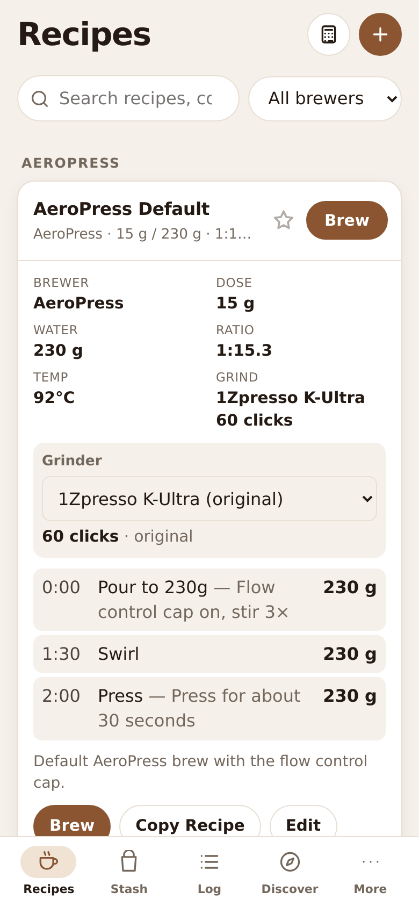
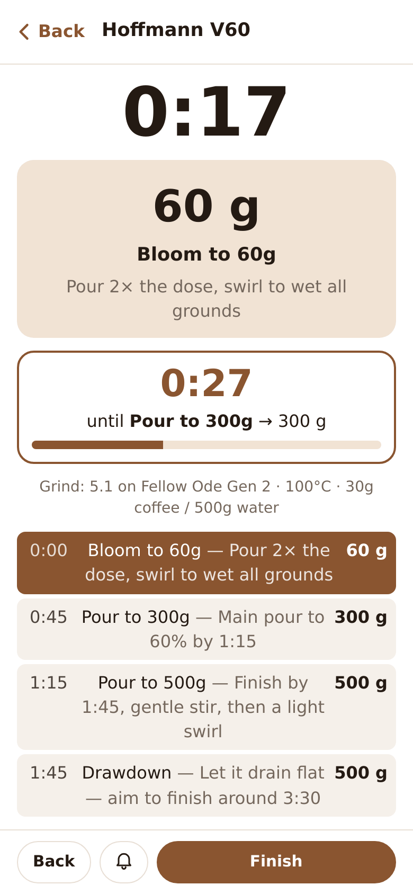
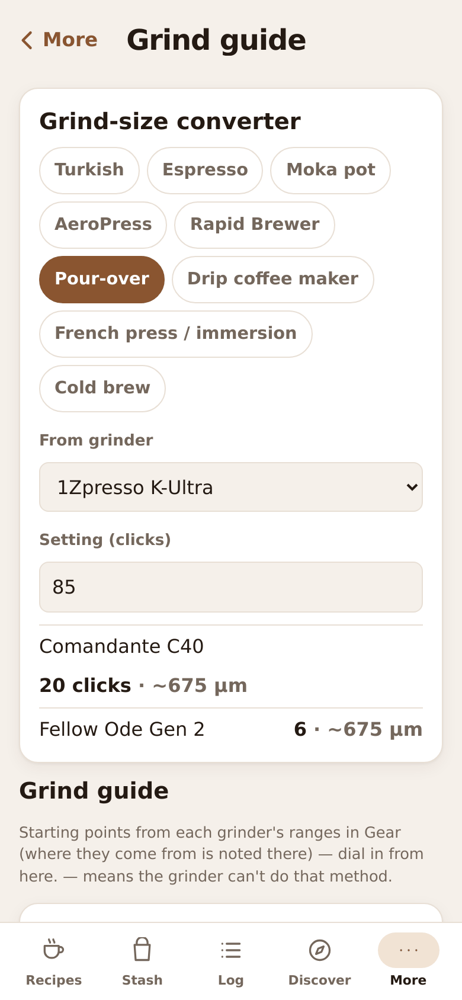
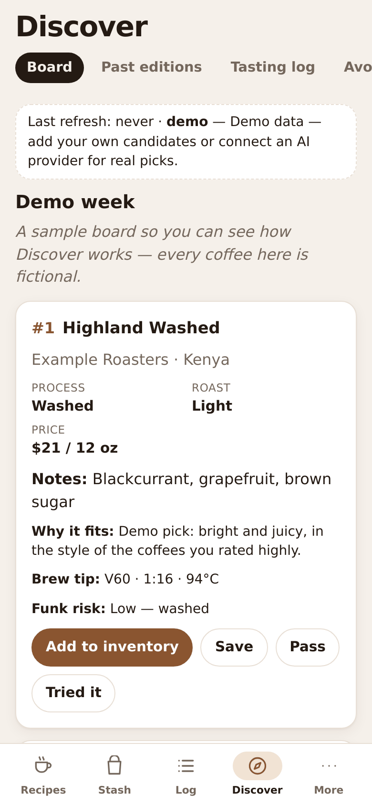
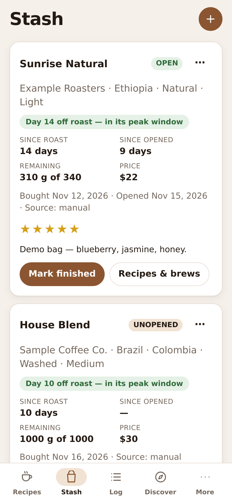

<h1>
  <picture>
    <source media="(prefers-color-scheme: dark)" srcset="brand/brewlab-refined-header.svg">
    
  </picture>
</h1>

A self-hosted coffee app for home brewers: one Docker container, one SQLite database, no account.

- **Brew:** recipes with a guided brew timer, ratio calculator, a grind guide that **converts settings between your grinders**, your coffee stash, a brew log, and your gear.
- **Discover:** a weekly board of coffees to try. It starts with popular picks and learns from what you rate. An AI provider is optional: with one, Brewlab researches roasters' current offerings; without one, you add candidates and Brewlab filters and ranks them.

It's built for phones first (installable as an app on iPhone and desktop), and works on tablets and desktops too.

<p align="center">
<picture><source media="(prefers-color-scheme: dark)" srcset="docs/screenshots/recipes-dark.png"></picture>
<picture><source media="(prefers-color-scheme: dark)" srcset="docs/screenshots/timer-dark.png"></picture>
<picture><source media="(prefers-color-scheme: dark)" srcset="docs/screenshots/guide-dark.png"></picture>
<picture><source media="(prefers-color-scheme: dark)" srcset="docs/screenshots/discover-dark.png"></picture>
<picture><source media="(prefers-color-scheme: dark)" srcset="docs/screenshots/stash-dark.png"></picture>
</p>

<sub>Recipes · the brew timer · the grind converter · Discover · your Stash (demo data, all fictional). Screenshots are made by <code>tests/e2e/screenshots.mjs</code>.</sub>

> ⚠️ **There is no login.** Anyone who can reach Brewlab can read and change everything in it. Run it on your home network or behind Tailscale/WireGuard, and if you put it behind a public hostname, **add authentication in your reverse proxy** (an access list, basic auth, Authelia, Cloudflare Access…). Never forward its port on your router.

---

## Quick start

```bash
git clone https://github.com/cmerkle/brewlab.git
cd brewlab
docker compose up -d
```

Open `http://<server-ip>:7642`. The first visit opens a short setup:

1. **Welcome:** set up your gear, explore with demo data (all fictional), or restore a Brewlab export.
2. **Brewers** and **grinders:** choose from the built-in library, or add your own. For a grinder that isn't listed, type the setting you use for a V60 and Brewlab proposes a pour-over range, so conversions work straight away.
3. **Preferences:** grams or ounces, °C or °F, default ratio.
4. **Starter recipes** that fit your gear, with grind settings already in your grinder's units.
5. **Discover:** on or off, an optional taste quiz, and an optional AI provider.

Every step can be skipped and redone from **More → Settings → Run setup again**.

| | |
|---|---|
| Logs | `docker compose logs -f` |
| Health | `curl -s localhost:7642/api/health` |
| Update | `docker compose pull && docker compose up -d` (or `git pull && docker compose up -d --build`). More → About shows your version and can check for new releases (off by default). |
| Stop | `docker compose down` (keeps your data) |

`docker compose down -v` **deletes the volume and all your data.**

### Network exposure

`docker-compose.yml` publishes port **7642 on every interface**, so devices on your network and a reverse proxy on another machine can reach it. Set `BREWLAB_PORT` in `.env` to use another host port. To keep it on the host only, change the mapping to `127.0.0.1:${BREWLAB_PORT:-7642}:7642`.

### HTTPS and installing the app

Browsers only offer "Install" (and the offline shell) over HTTPS. Put Brewlab behind a reverse proxy with a certificate (Nginx Proxy Manager, Caddy, Traefik, Cloudflare Tunnel, Tailscale Serve…), forwarding to `http://<server>:7642`. Then:

- **iPhone (Safari):** Share → *Add to Home Screen*.
- **Desktop (Chrome/Edge):** the install icon in the address bar.

And again: if that hostname is reachable from the internet, add authentication in the proxy.

## Your gear, not ours

Nothing about specific gear is in the code. The **gear library** (`catalog/gear/*.json`) and **recipe templates** (`catalog/recipes/*.json`) are data:

- Adding a model from the library gives you your own editable copy.
- Grinders come with grind ranges **only where a source is cited** (each shows its confidence and links its source). Every other grinder starts with "no conversion data yet". Add your own ranges under *Gear*, or use the calibration helper.
- Recipe templates store grind as a *position inside the method's range*, so a template renders onto whatever grinder you have.

**How conversion works:** a setting keeps its position inside the source grinder's range for that brew method and lands at the same position in the target grinder's range. Halfway through one grinder's pour-over range maps to halfway through the other's. Microns-per-click is never used.

Missing gear, or have a source for a grind range? Add it to your own Brewlab, then use **Suggest to the library** in its gear editor: Brewlab checks it and opens a ready-to-submit pull request on GitHub. Details in [CONTRIBUTING.md](CONTRIBUTING.md).

## Discover and AI providers

Set a provider in the app under **More → Settings → AI provider**: choose one, paste a key, then **Test connection**.

| Provider | Bag photo → fields | Weekly research |
|---|---|---|
| Anthropic | ✓ | ✓ web search |
| OpenAI | ✓ | ✓ web search |
| Google Gemini | ✓ | ✓ Google Search |
| OpenAI-compatible (Ollama, LM Studio, OpenRouter…) | ✓ if the model takes images | ✗ no web search, so research stays manual |

- **The key is write-only.** The app only reports whether one is saved. It's stored in `/data/secrets.json` (owner-only permissions), outside the database, so it's not in exports or backups.
- **Environment variables work too** (see [`.env.example`](.env.example)), and they take precedence when `LLM_API_KEY` or `LLM_BASE_URL` is set.
- **Without a provider everything still works:** bag photos use local OCR (Tesseract), and on *Discover → Refresh* you add candidates yourself (paste or import a roaster link).

**Adding a bag from a photo:** take a photo, choose one from your photos or files, paste an image, or drop it in (desktop). The image is converted to a JPEG on your device first, so iPhone HEIC photos and screenshots work. With a provider that has web search, Brewlab then looks the coffee up on the **roaster's own site**:
- it reads the product page with the same importer as a pasted link, falling back to what the search reported from that page;
- it fills only fields that are still empty, so the label and anything you typed always win;
- it shows which fields came from the web, and never guesses. If the coffee isn't found, the form says so.

"Look it up online" also works on a name and roaster you've typed in.

*Discover → Your taste* shows what the board is based on:
- **Ratings:** your Stash stars, brew ratings and tasting log, summarised by origin, process, roast and tasting notes.
- **How personal it gets:** popular picks with no ratings, a mix with 1–4 rated coffees, tailored picks from 5.
- **Always leave out:** hard filters you control. Each rule is a name plus words to look for in a coffee's name, process, roast and tasting notes. Brewlab starts you with suggestions you can turn on (cinnamon-forward, co-ferments or flavoured, fermentation funk, decaf, dark roasts, blends, robusta, smoky). Change their words, delete them, or add your own (say, "Peaberries: peaberry"). All start off; the app suggests one when you rate a few matching coffees low, and never turns one on by itself.
- **Exactly what the research is told,** shown word for word.

## Data and backups

Everything lives in the `brewlab-data` volume at `/data`: the database (`brewlab.db`), bag photos (`uploads/`), nightly snapshots (`backups/`, newest 14 kept) and `secrets.json` if you saved an AI key.

On **More** you can *Back up now*, download a snapshot, or *Export all data (JSON)*. An export can be restored from the first-run setup of a fresh install. For off-machine copies:

```bash
docker compose cp brewlab:/data ./brewlab-data-copy
```

To restore a snapshot: stop the app, copy it over `/data/brewlab.db` (delete any `brewlab.db-wal` / `-shm` beside it), make sure it's owned by the app user (uid 1000), and start again:

```bash
docker compose stop
docker run --rm -v brewlab_brewlab-data:/data alpine sh -c 'cp /data/backups/<snapshot>.db /data/brewlab.db && chown 1000:1000 /data/brewlab.db && rm -f /data/brewlab.db-wal /data/brewlab.db-shm'
docker compose start
```

## Configuration

All optional, set as environment variables. Compose reads a `.env` file next to `docker-compose.yml`.

| Variable | Default | Purpose |
|---|---|---|
| `TZ` | `UTC` | Time zone for the Monday 08:00 refresh, nightly backup and "today". |
| `LLM_PROVIDER`, `LLM_API_KEY`, `LLM_MODEL`, `LLM_BASE_URL` | *(unset)* | AI provider via environment instead of the in-app form. `LLM_MODEL` is required except for Anthropic. |
| `BACKUP_KEEP` | `14` | Snapshots to keep. |
| `DISABLE_CRON` | *(unset)* | `1` turns off the weekly refresh and nightly backup. |
| `IMPORT_ALLOW_HOSTS` | *(unset)* | Hosts the link importer may fetch even though they're private addresses (normally refused). |
| `LIBRARY_REPO` | `cmerkle/brewlab` | The GitHub repo (`owner/name`) used for "Suggest to the library", More → About's links and the optional update check. Set it if you run a fork. |
| `SEED_DIR` | `/app/seed-data` | Optional starting data for a new install (see [`seed-data/README.md`](seed-data/README.md)). |

## Development

```bash
npm ci
npm run build            # Vite → dist/public, tsc → dist/server.js
npm run typecheck
npm test                 # unit tests (run after build)
HOST=127.0.0.1 PORT=3100 DATA_DIR=./.dev-data DISABLE_CRON=1 npm start
```

Works on Node 20+; the image runs Node 24.

End-to-end checks (Playwright) live in `tests/e2e`:

```bash
cd tests/e2e && npm i && npx playwright install chromium
# first-run setup, on an EMPTY install:
docker run -d --rm --name brewlab-empty -p 127.0.0.1:3103:7642 ghcr.io/cmerkle/brewlab:latest
BASE=http://localhost:3103 npm run onboarding
# layout audit (phones, foldables, desktop), on a fresh install with demo data loaded:
docker run -d --rm --name brewlab-demo -p 127.0.0.1:3104:7642 ghcr.io/cmerkle/brewlab:latest
curl -XPOST localhost:3104/api/setup/demo && curl -XPOST localhost:3104/api/setup/complete
ONLY="iPhone SE portrait" BASE=http://localhost:3104 npm run layout   # one viewport per run keeps memory low
# README screenshots (same demo install):
BASE=http://localhost:3104 node screenshots.mjs
```

Before tagging a release, rehearse the update on an older install: `scripts/upgrade-test.sh [old-ref]` builds the old version and this checkout, loads the demo data into the old one, then starts the new one on the same volume and checks nothing was lost (default old-ref: the latest `v*` tag).

## License

[MIT](LICENSE)
