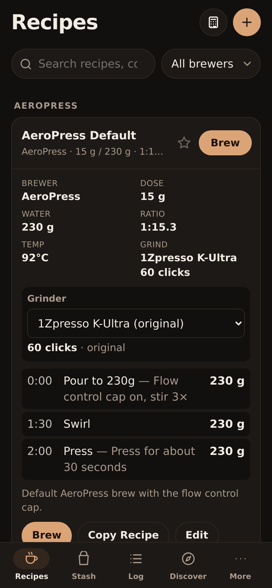
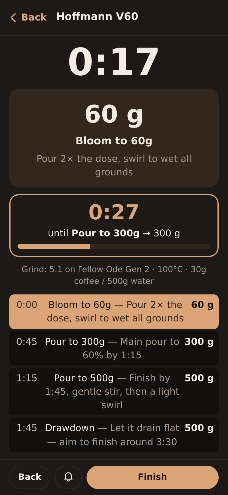
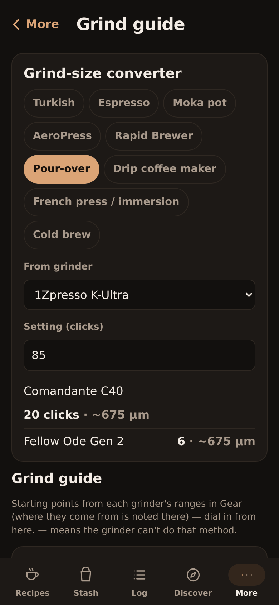
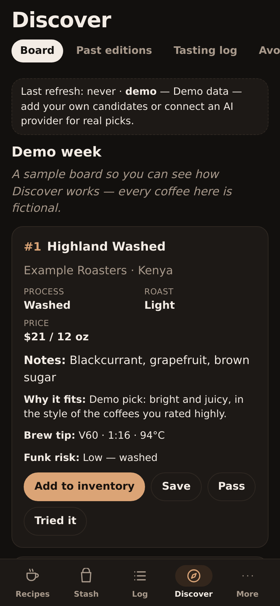
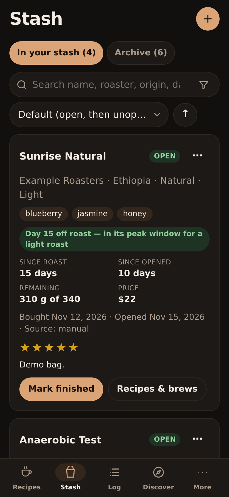
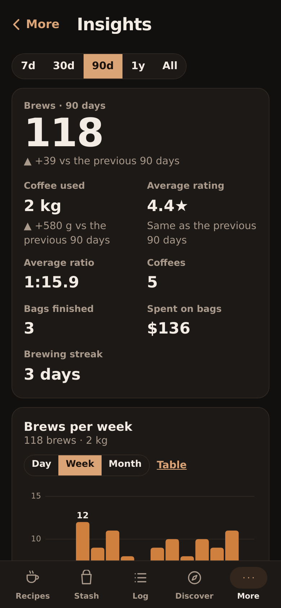
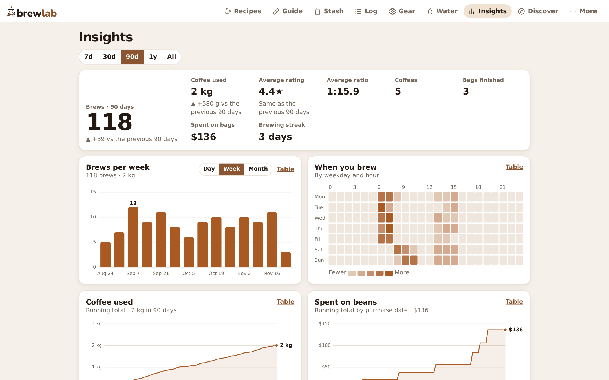
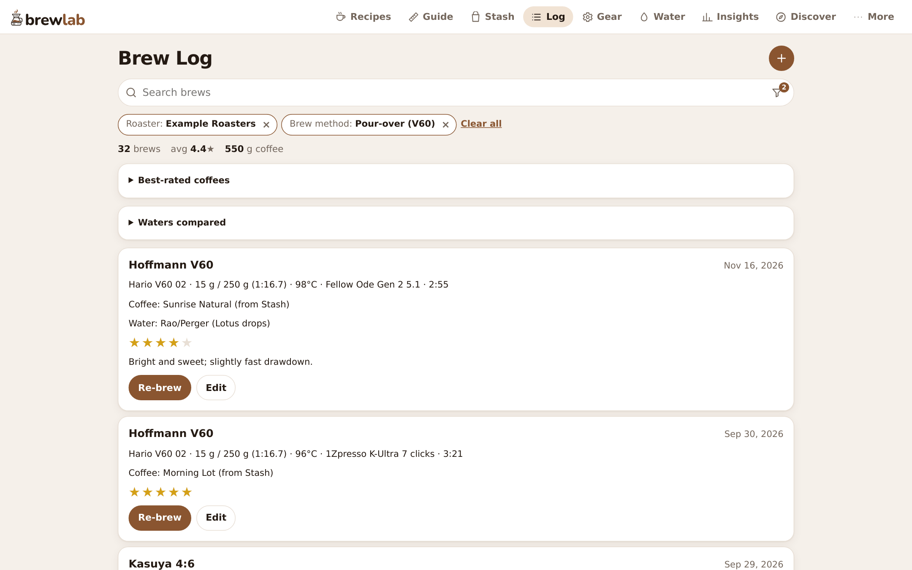
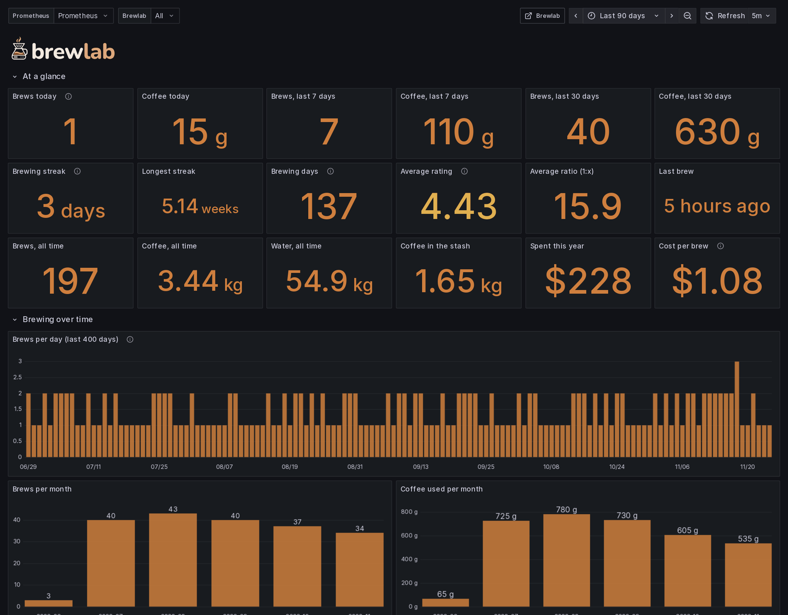

<h1>
  <picture>
    <source media="(prefers-color-scheme: dark)" srcset="brand/brewlab-refined-header.svg">
    
  </picture>
</h1>

A self-hosted coffee app for home brewers: one Docker container, one SQLite database, no account.

- **Brew:** recipes with a guided brew timer, ratio calculator, a grind guide that **converts settings between your grinders**, your coffee stash, a brew log, your gear, **water recipes** you can compare in the log, and **Insights**: charts of your brewing habits and what you rate highest.
- **Discover:** a weekly board of coffees to try. It starts with popular picks and learns from what you rate. An AI provider is optional: with one, Brewlab researches roasters' current offerings; without one, you add candidates and Brewlab filters and ranks them.

It's built for phones first and works just as well on tablets and computers. Install it from the browser to use it like an app.

<p align="center">






</p>

<p align="center">


</p>

<sub>Recipes · the brew timer · the grind converter · Discover · your Stash · Insights; on a computer, Insights and the Brew Log with two filters on (demo data and made-up history, all fictional). Screenshots are made by <code>tests/e2e/screenshots.mjs</code>.</sub>

> ⚠️ **There is no login.** Anyone who can reach Brewlab can read and change everything in it. Run it on your home network or behind Tailscale/WireGuard, and if you put it behind a public hostname, **add authentication in your reverse proxy** (an access list, basic auth, Authelia, Cloudflare Access…). Never forward its port on your router.

---

## Quick start

```bash
git clone https://github.com/cmerkle/brewlab.git
cd brewlab
docker compose up -d
```

Open `http://<server-ip>:7642`. The first visit opens a short setup:

1. **Welcome:** set up your gear, explore with demo data (all fictional), or restore a Brewlab export.
2. **Brewers** and **grinders:** choose from the built-in library, or add your own. For a grinder that isn't listed, type the setting you use for a V60 and Brewlab proposes a pour-over range, so conversions work straight away.
3. **Preferences:** grams or ounces, °C or °F, default ratio.
4. **Starter recipes** that fit your gear, with grind settings already in your grinder's units.
5. **Discover:** on or off, a few optional taste tags, and an optional AI provider.

Every step can be skipped and redone from **More → Settings → Run setup again**.

| | |
|---|---|
| Logs | `docker compose logs -f` |
| Health | `curl -s localhost:7642/api/health` |
| Update | `docker compose pull && docker compose up -d` (or `git pull && docker compose up -d --build`). More → Settings → About shows your version and can check for new releases (off by default). |
| Stop | `docker compose down` (keeps your data) |

`docker compose down -v` **deletes the volume and all your data.**

### Network exposure

`docker-compose.yml` publishes port **7642 on every interface**, so devices on your network and a reverse proxy on another machine can reach it. Set `BREWLAB_PORT` in `.env` to use another host port. To keep it on the host only, change the mapping to `127.0.0.1:${BREWLAB_PORT:-7642}:7642`.

### HTTPS and installing the app

Browsers only offer "Install" (and the offline shell) over HTTPS. Put Brewlab behind a reverse proxy with a certificate (Nginx Proxy Manager, Caddy, Traefik, Cloudflare Tunnel, Tailscale Serve…), forwarding to `http://<server>:7642`. Then:

- **iPhone (Safari):** Share → *Add to Home Screen*.
- **Desktop (Chrome/Edge):** the install icon in the address bar.

And again: if that hostname is reachable from the internet, add authentication in the proxy.

## Your gear, not ours

Nothing about specific gear is in the code. The **gear library** (`catalog/gear/*.json`) and **recipe templates** (`catalog/recipes/*.json`) are data:

- Adding a model from the library gives you your own editable copy.
- Grinders come with grind ranges **from a cited source**: the maker's chart or a published community chart, linked in the gear editor. Methods a source leaves out are estimated from the grinder's own ranges (rules in `catalog/estimate-rules.json`) and marked "est."; methods a grinder can't do show "—". A grinder with no ranges (or one you add yourself) says "no conversion data yet" until you type its ranges in *Gear* or use the calibration helper.
- Recipe templates store grind as a *position inside the method's range*, so a template renders onto whatever grinder you have.

**How conversion works:** a setting keeps its position inside the source grinder's range for that brew method and lands at the same position in the target grinder's range. Halfway through one grinder's pour-over range maps to halfway through the other's. Microns-per-click is never used.

Missing gear, or have a source for a grind range? Add it to your own Brewlab, then use **Suggest to the library** in its gear editor: Brewlab checks it and opens a ready-to-submit pull request on GitHub. Details in [CONTRIBUTING.md](CONTRIBUTING.md).

## Water recipes

*More → Water* holds your brewing waters: a base water (distilled, RO, ZeroWater, tap, bottled or your own), how much, and what you add, each with its amount in g, mg, ml, drops, packets, tsp or capsules.

- **Hardness (GH) and alkalinity (KH)** are worked out as you type, in ppm as CaCO₃. Pure salts (Epsom salt, baking soda, potassium bicarbonate, calcium and magnesium chloride) are calculated from their molar mass. Products use the maker's or a published figure (Lotus drops, Third Wave Water). Anything that isn't published, like Third Wave Water's hardness, shows as "—" and is never guessed. Your own additive can say what it adds, if you know.
- **Concentrates:** mark a water as a concentrate (a stock solution, say 6.8 g calcium chloride in 1 L) and other waters can add it by the gram, with the hardness worked out through it.
- **A library** of cited recipes (`catalog/water/*.json`, additives in `catalog/water-additives.json`): the Third Wave Water profiles, two Lotus drop recipes (Light & Bright, Rao/Perger) and Barista Hustle's concentrate recipes (Melbourne, Budapest, SCA, Barista Hustle Water, Rao, Hendon, Pretty Hard, Hard dot AF, plus the original filter recipe and an espresso one), with their concentrates. Library entries hold only the numbers and a link to the source. Adding one gives you your own copy.
- **Linked to brewing:** a recipe can have a default water, Brew setup lets you pick the water you're using, and each brew records it. The Brew Log filters by water (and anything else) and compares how each one rated (for a recipe or coffee too), so you can try one coffee with different waters.

## Insights

*More → Insights* turns your brew log and Stash into charts, for the last 7, 30 or 90 days, a year, or all time:

- **Headline numbers:** brews (against the previous period), coffee used, average rating and ratio, coffees, bags finished, money spent on bags, and your brewing streak.
- **Brews per day / week / month,** and **when you brew** (weekday × hour).
- **Running totals** of coffee used (grams from your brews) and money spent on beans (bag prices, by purchase date) across the period.
- **Rating and ratio** distributions.
- **Brewers, grinders, recipes, brew methods and waters,** by number of brews or by grams of coffee used.
- **Your coffee by roaster, origin, roast level and process:** counted by brews or grams of coffee used in the period, by bags in your Stash now, or by every bag you've had (a switch on that section).
- **What you rate highest:** average brew rating by origin, process, roaster or roast level (where you've rated at least two brews).

Every chart has a *Table* view, and hovering or tabbing to a bar shows its numbers.

## Search and filters (Brew Log, Stash and Archive)

The search box matches every word anywhere in a brew: recipe, coffee and its bag (roaster, origin, process, roast level, tasting notes), brewer, grinder, grind setting, water, notes, dose ("18g") or date ("november"). The **filter button** in the search box opens filters for coffee, roaster, origin, roast level, process, recipe, brew method, brewer, grinder, water, rating and a date range. Pick several values in one group to see any of them; groups combine. Each value shows how many brews it would leave, given the rest. What's on appears as chips under the search box; × removes one.

The **Stash** and its **Archive** have the same filter button (each tab keeps its own filters): status, rest window (resting / in its peak window / past its peak, from *Rest and peak window* in Settings), roaster, origin, roast level, process, tasting-note tags, rating, and date ranges for roasted, bought, opened and finished. A group with only one value is left out, since it couldn't narrow anything.

**Ratings go in half stars** (½ to 5). Tap the left half of a star for x.5 and the right half for the whole star; tap your rating again to clear it.

## Prometheus metrics (Grafana)

Turn on **More → Settings → Prometheus metrics** and Brewlab serves `GET /metrics` in the Prometheus text format (it's a 404 while off, the default). Scrape it like any target:

```yaml
scrape_configs:
  - job_name: brewlab
    scrape_interval: 60s
    static_configs:
      - targets: ["<brewlab-host>:7642"]
```

All metrics start with `brewlab_`. Among them:

| Metric | What |
| --- | --- |
| `brews_total`, `coffee_used_grams_total`, `water_used_grams_total` | Every brew logged, and what went into them |
| `brews_window{window}`, `coffee_used_window_grams{window}` | Today and the last 7 / 30 / 90 / 365 local days, so a dashboard works from the first scrape |
| `brews_by_<dim>_total`, `coffee_used_by_<dim>_grams_total`, `brew_rating_average_by_<dim>` | Per `coffee`, `roaster`, `origin`, `roast_level`, `process`, `recipe`, `method`, `brewer`, `grinder`, `water` (`none` = not recorded) |
| `brews_by_rating_total{rating}`, `brew_rating_average`, `brew_ratio_average`, `brewing_streak_days` | Ratings, ratio, streak |
| `last_brew_*` | Timestamp, dose, water, rating, temperature and duration of the latest brew |
| `bags{status}`, `stash_remaining_grams`, `spent_total`, `spent_by_roaster_total`, `spent_this_year` | The Stash and spending (prices in your currency) |
| `bag_remaining_grams`, `bag_size_grams`, `bag_used_grams`, `bag_brews_total`, `bag_price`, `bag_rating`, `bag_days_off_roast`, `bag_days_open`, `bag_freshness{state}` | Each bag not finished yet, labelled with id, name, roaster, origin, roast level, process and status; `state` is resting / peak / past for its rest window |
| `gear_items{type}`, `recipes{kind}`, `water_recipes`, `discover_*`, `tastings{verdict}`, `avoids`, `backups`, `last_backup_timestamp_seconds`, `database_bytes`, `info{version}` | Everything else |

There's no login on `/metrics`, the same as the rest of the app: keep Brewlab on your LAN (see *Network exposure*).

History metrics carry their time in a label (`brews_by_month_total{month}`, `brews_by_day_total{day}` for the last 400 days, `brews_by_weekday_hour_total{weekday,hour}`, `spent_by_month_total`, `bags_bought_by_month_total`, `coffee_bought_by_month_grams_total`, `coffee_brewed_cost_by_month_total`), so charts show your whole history from the first scrape. Also: `brews_by_ratio_total`, per-method averages (dose, ratio, time, temperature), every bag you've had by roaster / origin / roast level / process with average bag ratings, `bags_by_tasting_note_total`, price per kg, cost per brew, and how long bags last.

### Grafana dashboard

<p align="center"></p>

[`grafana/brewlab-dashboard.json`](grafana/brewlab-dashboard.json) is a ready-made dashboard (115 panels, under the Brewlab wordmark): at a glance; brewing over time (daily for 400 days, monthly, rolling windows); the latest brew; when you brew (weekday × hour); ratings and ratios; gear (brews, coffee and ratings per brewer, grinder and method, plus method averages); recipes and water; your coffee by roaster, origin, roast level and process (what you brew, how you rate it, every bag you've had, tasting notes); the stash (a table of every open bag with its rest window, coffee left per bag over time); buying coffee (spend and bags per month, bought vs brewed, cost of what you brewed, spend by roaster); Discover, backups and the instance. In Grafana: *Dashboards → New → Import*, upload the file and pick your Prometheus data source. Money is shown in US dollars; change the panels' unit if you buy in another currency. The file is generated: edit `scripts/grafana-dashboard.mjs` and run `node scripts/grafana-dashboard.mjs`.

## Discover and AI providers

Set a provider in the app under **More → Settings → AI provider**: choose one, paste a key, then **Test connection**.

| Provider | Bag photo → fields | Weekly research |
|---|---|---|
| Anthropic | ✓ | ✓ web search |
| OpenAI | ✓ | ✓ web search |
| Google Gemini | ✓ | ✓ Google Search |
| OpenAI-compatible (Ollama, LM Studio, OpenRouter…) | ✓ if the model takes images | ✗ no web search, so research stays manual |

- **The key is write-only.** The app only reports whether one is saved. It's stored in `/data/secrets.json` (owner-only permissions), outside the database, so it's not in exports or backups.
- **Environment variables work too** (see [`.env.example`](.env.example)), and they take precedence when `LLM_API_KEY` or `LLM_BASE_URL` is set.
- **Without a provider everything still works:** bag photos use local OCR (Tesseract), and on *Discover → Refresh* you add candidates yourself (paste or import a roaster link).

**Adding a bag from a photo:** take a photo, choose one from your photos or files, paste an image, or drop it in (desktop). The image is converted to a JPEG on your device first, so iPhone HEIC photos and screenshots work. With a provider that has web search, Brewlab then looks the coffee up on the **roaster's own site**:
- it reads the product page with the same importer as a pasted link, falling back to what the search reported from that page;
- it fills only fields that are still empty, so the label and anything you typed always win;
- it shows which fields came from the web, and never guesses. If the coffee isn't found, the form says so.

"Look it up online" also works on a name and roaster you've typed in.

*Discover → Your taste* shows what the board is based on:
- **Ratings:** your Stash stars, brew ratings and tasting log, summarised by origin, process, roast and tasting notes.
- **How personal it gets:** popular picks with no ratings, a mix with 1–4 rated coffees, tailored picks from 5.
- **Your preferences, as tags,** in five sections: roasters, processes, roast level, origins and tasting notes. Each has **Preferred** and **Rather avoid** (soft: they steer the research and the ranking) and **Do not include** (hard: a matching coffee is left out). Tap a tag to switch it on or off, × to remove it, or type your own. Built-in tags start off: flavours (berries, citrus, chocolate …), processes, roast levels, and exclusions such as cinnamon-forward, co-ferments, fermentation funk, decaf, dark roasts, blends and robusta. The app suggests switching an exclusion on when you rate a few matching coffees low, and never does it by itself.
- **Exactly what the research is told,** shown word for word.

## Data and backups

Everything lives in the `brewlab-data` volume at `/data`: the database (`brewlab.db`), bag photos (`uploads/`), nightly snapshots (`backups/`, newest 14 kept unless you change it) and `secrets.json` if you saved an AI key.

On **More → Settings** you can *Back up now*, download or delete a snapshot, set how many to keep, or *Export all data (JSON)*. An export can be restored from the first-run setup of a fresh install. For off-machine copies:

```bash
docker compose cp brewlab:/data ./brewlab-data-copy
```

To restore a snapshot: stop the app, copy it over `/data/brewlab.db` (delete any `brewlab.db-wal` / `-shm` beside it), make sure it's owned by the app user (uid 1000), and start again:

```bash
docker compose stop
docker run --rm -v brewlab_brewlab-data:/data alpine sh -c 'cp /data/backups/<snapshot>.db /data/brewlab.db && chown 1000:1000 /data/brewlab.db && rm -f /data/brewlab.db-wal /data/brewlab.db-shm'
docker compose start
```

## Configuration

All optional, set as environment variables. Compose reads a `.env` file next to `docker-compose.yml`.

| Variable | Default | Purpose |
|---|---|---|
| `TZ` | `UTC` | Time zone for the Monday 08:00 refresh, nightly backup and "today". |
| `LLM_PROVIDER`, `LLM_API_KEY`, `LLM_MODEL`, `LLM_BASE_URL` | *(unset)* | AI provider via environment instead of the in-app form. `LLM_MODEL` is required except for Anthropic. |
| `BACKUP_KEEP` | `14` | Snapshots to keep, unless set in More → Settings → Backups. |
| `DISABLE_CRON` | *(unset)* | `1` turns off the weekly refresh and nightly backup. |
| `IMPORT_ALLOW_HOSTS` | *(unset)* | Hosts the link importer may fetch even though they're private addresses (normally refused). |
| `LIBRARY_REPO` | `cmerkle/brewlab` | The GitHub repo (`owner/name`) used for "Suggest to the library", More → Settings → About's links and the optional update check. Set it if you run a fork. |
| `SEED_DIR` | `/app/seed-data` | Optional starting data for a new install (see [`seed-data/README.md`](seed-data/README.md)). |

## Development

```bash
npm ci
npm run build            # Vite → dist/public, tsc → dist/server.js
npm run typecheck
npm test                 # unit tests (run after build)
HOST=127.0.0.1 PORT=3100 DATA_DIR=./.dev-data DISABLE_CRON=1 npm start
```

Works on Node 20+; the image runs Node 24.

End-to-end checks (Playwright) live in `tests/e2e`:

```bash
cd tests/e2e && npm i && npx playwright install chromium
# first-run setup, on an EMPTY install:
docker run -d --rm --name brewlab-empty -p 127.0.0.1:3103:7642 ghcr.io/cmerkle/brewlab:latest
BASE=http://localhost:3103 npm run onboarding
# layout audit (phones, foldables, desktop), on a fresh install with demo data loaded:
docker run -d --rm --name brewlab-demo -p 127.0.0.1:3104:7642 ghcr.io/cmerkle/brewlab:latest
curl -XPOST localhost:3104/api/setup/demo && curl -XPOST localhost:3104/api/setup/complete
ONLY="iPhone SE portrait" BASE=http://localhost:3104 npm run layout   # one viewport per run keeps memory low
# README screenshots (same demo install):
BASE=http://localhost:3104 npm run screenshots
```

Before tagging a release, rehearse the update on an older install: `scripts/upgrade-test.sh [old-ref]` builds the old version and this checkout, loads the demo data into the old one, then starts the new one on the same volume and checks nothing was lost (default old-ref: the latest `v*` tag).

## Contributing and bug reports

Gear and grind ranges are the most useful contributions, and they're plain JSON: see [CONTRIBUTING.md](CONTRIBUTING.md). Found a bug? **More → Settings → About → Report a bug** opens a GitHub issue with your version and device filled in. Security problems: see [SECURITY.md](SECURITY.md).

## License

[MIT](LICENSE)
